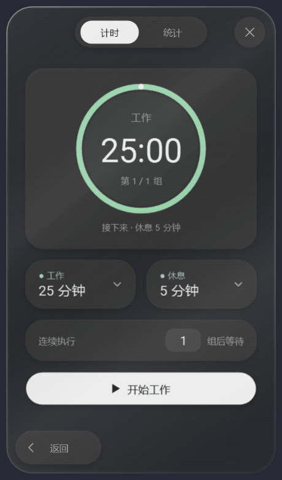
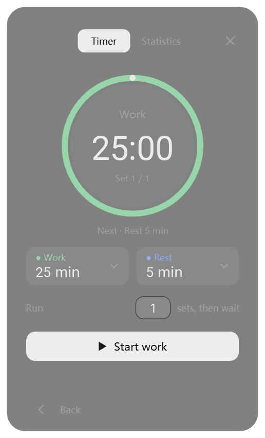
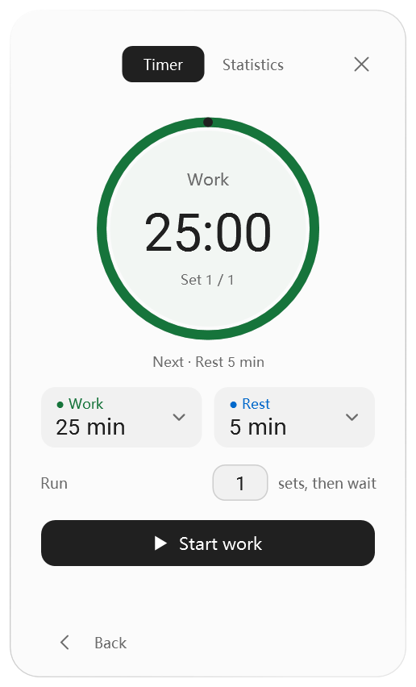
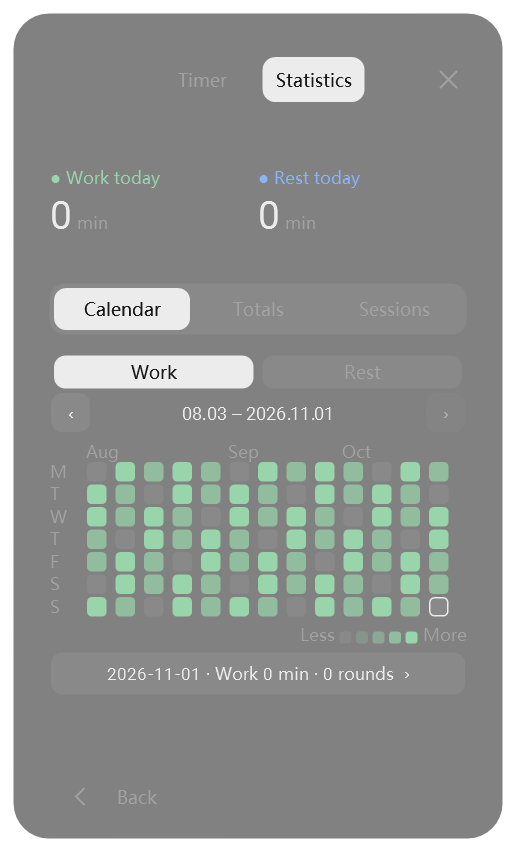
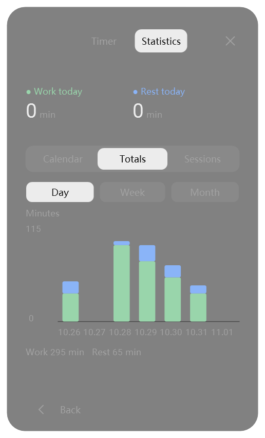
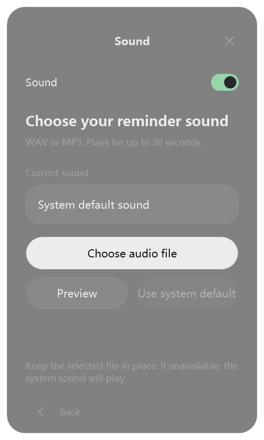

# Codex Mini Menu

**2.16.0: Conic lighting and high-refresh movement.** Moving interactions target 90+ updates/second. The docked launcher shares the card's glass material, with a rotating angular border and visible diffuse breathing light. [Measurements and development rules](docs/conic-motion-2.16.0.md)

**2.15.0: Faster floating editors and theme lighting.** Duration editors open in 190 ms, with compact spacing, smoother reflective light and launcher handoff. A rotating theme border and breathing bottom glow follow the current appearance. [Details and validation](docs/motion-polish-2.15.0.md)

Work and rest duration islands expand into floating glass editors from their own positions. Backdrop blur increases smoothly from zero and reverses on dismissal. [Interaction details](docs/duration-float.md)

<p align="center"></p>

**2.14.1:** Align the Back capsule with the launcher and the card corner, including the mirrored layout.

**2.14.0: Refined card motion.** Concentric corner controls, consistent text rendering and a launcher that tilts with the card. Separate reflection rendering and cached content improve animation performance. See [measurements and tradeoffs](docs/card-refinement-2.14.0.md).

**2.13.0: Silver glass card.** Hold the right mouse button and move to tilt the entire live menu. Silver highlights follow the angle; release to return smoothly. Timers keep updating throughout. See the [upgrade details](docs/silver-card-2.13.0.md).

<p align="center"></p>

Version 2.11.0 adds **Context**: the launcher center follows the current chat's context usage, turns orange at 80% and red at 90%, and shows one reminder per chat. See [module details and compatibility](CONTEXT.md).

**A floating Windows utility menu that follows Codex.** Expand from a circular launcher, match the Codex theme, and enjoy silver reflections, adjustable transparency and a frosted-glass finish. Built-in work/rest timers and a contribution-style activity heatmap help you track your focus, with more tools to come.

**Windows 10 / 11 · .NET Framework 4.8 · English / 简体中文**

**English** · [简体中文](README.zh-CN.md) · [Download](https://github.com/originnal090/codex-mini-menu/archive/refs/heads/main.zip) · [Issues & ideas](https://github.com/originnal090/codex-mini-menu/issues)

## A menu that expands from its launcher

Click the floating ring to expand the menu from its position; closing brings it back. The launcher follows the active Codex window and can be dragged to a comfortable position. Use the lower-left back button to return from a tool to the menu.

<p align="center"></p>

## Colors that follow your Codex theme

The menu reads Codex's appearance configuration and follows its light/dark theme and palette. Backgrounds, text, controls and accents update together while your timer state stays intact.

<table>
<tr><th>Dark theme</th><th>Light theme</th></tr>
<tr><td></td><td></td></tr>
</table>

## Silver reflections and tactile interactions

Hold the right mouse button and move to tilt the silver glass card; the highlight moves with its angle. Release to return to rest. Drag the statistics selector with gentle damping; text changes color exactly where the thumb passes. Buttons compress with an inset shadow, then gently rebound on release.

<p align="center"></p>

*When system animations are disabled, the card returns to rest immediately on release.*

## A contribution-style heatmap for your focus

The activity heatmap is generated automatically from actual timer records. Explore 13 weeks at a time, switch between work and rest, browse earlier dates, or select a day for its session timeline. Totals offer daily, weekly and monthly breakdowns with distinct work/rest colors.

<table>
<tr><th>Daily activity heatmap</th><th>Separate work / rest totals</th></tr>
<tr><td></td><td></td></tr>
</table>

*Statistics shown here use demonstration data. Pauses are excluded; live elapsed time is included, and resetting retains active time already recorded.*

## Adjustable transparency and frosted glass

Set transparency from 0–90% in **Settings → Appearance**. The menu, timer and floating ring update together. Translucent fills, gradient edges and background blur create a layered glass finish that blends with your desktop.

<table>
<tr><th>Lower transparency · 15%</th><th>Higher transparency · 75%</th></tr>
<tr><td></td><td></td></tr>
</table>

*Captured against the same demonstration backdrop with system blur disabled (translucent fallback). Background blur depends on Windows composition support and system transparency settings; its appearance also varies with the background.*

## Choose your reminder sound

In **Settings → Sound**, toggle reminders, choose a custom WAV / MP3 file, preview it, or restore the system default.

<p align="center"></p>

## Work and rest in configurable groups

- Set work and rest separately, from **1 second to 24 hours** per phase, using hour/minute/second wheels.
- A group is **work → rest**. Run one group by default, or choose **1–99 groups**, then wait for the next start.
- Circular progress shows the phase, remaining time and group count. Pause, resume or reset at any time.
- Closing the panel keeps the timer running. After sleep or an application restart, it catches up using its absolute deadline. Reminders cannot play while the application is closed or Windows is asleep.

## Install and get started

1. [Download the ZIP](https://github.com/originnal090/codex-mini-menu/archive/refs/heads/main.zip), or use **Code → Download ZIP**.
2. Extract the entire archive and run **`install.cmd`**.
3. Open the **Codex Mini Menu** desktop shortcut. The tray menu also provides open, position reset and exit actions.

The installer registers the local Codex plugin and creates shortcuts. Upgrading preserves state and preferences. Requires .NET Framework 4.8; no Node.js or Python runtime is needed. Run `uninstall.cmd` to uninstall.

State, appearance, sound preferences and history are stored locally in `%USERPROFILE%\.codex\timer-data`.

## Build and verify

Open `CodexMiniMenu.code-workspace`, or run `powershell -NoProfile -ExecutionPolicy Bypass -File ./dev.ps1 -Action TestUI`. See the [development and release guide](docs/development.md).

```powershell
powershell -ExecutionPolicy Bypass -File source/scripts/build.ps1
powershell -ExecutionPolicy Bypass -File source/scripts/test-cycle.ps1
powershell -ExecutionPolicy Bypass -File source/scripts/test-stats.ps1
powershell -ExecutionPolicy Bypass -File source/scripts/test-work-rest.ps1
powershell -ExecutionPolicy Bypass -File source/scripts/package.ps1
```

Run these commands in Windows PowerShell. Packages are generated under `dist/`; UI tests require an interactive Windows desktop. Implementation lives in `source/src/`, tests in `source/tests/`, and build/verification scripts in `source/scripts/`.

## Contribute

Share suggestions and bugs through [Issues](https://github.com/originnal090/codex-mini-menu/issues), or fork the repository and open a pull request with the behavior change and validation details for maintainer review.

## Fonts and licensing

The interface uses Microsoft YaHei and Roboto. Roboto’s license is included in [LICENSE-Roboto.txt](plugin/assets/fonts/LICENSE-Roboto.txt); a project source license has not yet been selected. This is an independent community project for use with Codex.
