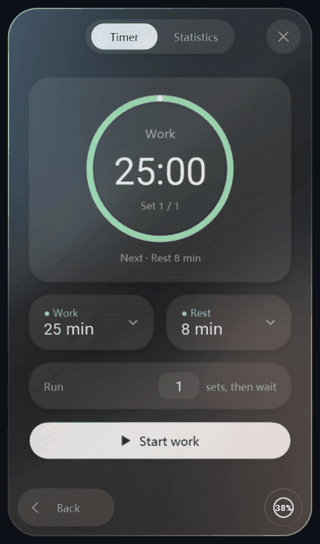
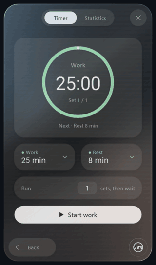
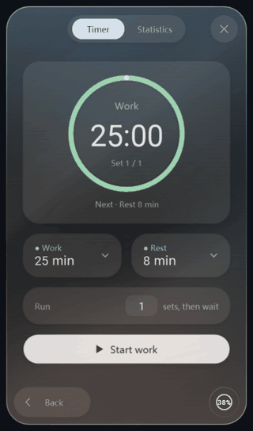
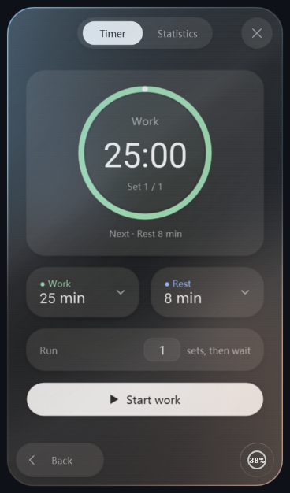
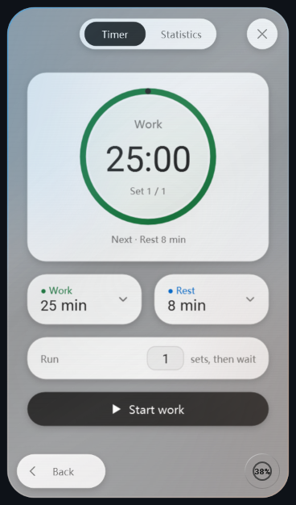

# Codex Mini Menu — Windows Timer & Break Reminder

**Build something great. Remember to get out of your chair.**

A floating desktop timer and break reminder for Codex on Windows. Set a countdown or a customizable Pomodoro-style work/rest cycle, track your focus time, and keep an eye on chat context usage. Its glass card tilts with live reflections while two soft colors orbit through the background and border.

**English** · [简体中文](README.zh-CN.md) · **[Download v2.17.0](https://github.com/originnal090/codex-mini-menu/releases/latest)** · [What's new](CHANGELOG.md) · [Ideas & feedback](https://github.com/originnal090/codex-mini-menu/issues)

Windows 10 / 11 · .NET Framework 4.8 · English / 简体中文

## Why I built it

One more prompt. One more idea. One more thing to try with Codex… and suddenly, hours have disappeared. I would get so absorbed in the conversation that I barely moved from my chair, then notice my back aching when I finally stood up.

So I built a small reminder to look after the person writing the code, too. Set a work session, let the ring keep time, and take that nudge to stand up, stretch, or go for a short walk. I want to keep the joy of building things **and** remember to take a break!

And if a little tool is going to sit beside me all day, I want it to feel lovely to use. That's where the glass, the moving light, and the card you can tilt come in.

## A glass card with a little life in it

<table>
<tr><th>Rotating diffuse light</th><th>Live reflective card</th></tr>
<tr><td></td><td></td></tr>
</table>

**Light that travels through the whole card.** Two soft, theme-derived colors revolve around the center, one turn every **12 seconds**. The background and conic gradient border share the same color field and angle: wherever the glow goes, the edge follows. The center gently fades into the glass.

**A card you can play with.** Hold the **right mouse button** and move to tilt the menu in perspective. Its silver reflection follows the angle; release and it eases back into place. Controls and timer content stay live, and the launcher travels with the card during the tilt.

*Scripted renders of the actual WPF interface, with demonstration data. GIFs are compressed for the README; their playback rate is not a performance benchmark.*

## Small interactions, carefully finished

<p align="center"></p>

Click **Work** or **Rest** and that island expands into a floating duration editor. The background blurs in gently, the time wheels stay crisp, and the sheet settles into place in **190 ms**.

- **Click the ring** to open or close the menu; **left-drag it** to move it, including while the card is open.
- The launcher follows the active Codex window. Rounded islands keep the tools close at hand.
- Hover light, elastic button feedback and a damped statistics selector add a little tactile polish.
- Codex's light/dark appearance and palette are followed automatically; transparency is adjustable from **0–90%**.
- Animation preferences are respected; hidden cards stop their lighting animation.

<table>
<tr><th>Dark glass</th><th>Light glass</th></tr>
<tr><td></td><td></td></tr>
</table>

## Useful while you're making things

| Tool | What it does |
| --- | --- |
| Work / rest timer | Set each phase from **1 second to 24 hours**. Run **1–99 groups** of work → rest, with pause, resume and reset. |
| Reminder sound | Enable reminders, choose your own WAV / MP3, preview it, or use the system sound. |
| Activity statistics | A **13-week heatmap**, daily session timelines, and separate work/rest totals by day, week and month. |
| Context meter | Current chat usage inside the launcher; orange at 80%, red at 90%, with one threshold reminder per chat. [Compatibility](CONTEXT.md) |

Closing the menu keeps the timer running. After sleep or restart, it catches up using its absolute deadline; reminders cannot sound while the app is closed or Windows is asleep. Statistics use actual timer records and exclude paused time.

## Install and take your first break

1. Open the **[latest release](https://github.com/originnal090/codex-mini-menu/releases/latest)** and download `CodexMiniMenu-Windows-2.17.0.zip`.
2. Extract the entire archive and run **`install.cmd`**.
3. Open the **Codex Mini Menu** desktop shortcut, set your work/rest times, and get started!

The installer registers the local Codex plugin and creates shortcuts. Upgrades preserve state and preferences. Requires .NET Framework 4.8; no Node.js or Python runtime is needed to run the menu. The tray provides open, reset-position and exit actions; run `uninstall.cmd` to uninstall.

State, history, appearance and sound preferences stay in `%USERPROFILE%\.codex\timer-data`. Windows backdrop blur depends on composition support and system transparency settings.

## Recent milestones, saved

From floating islands to reflective motion, faster editors and synchronized rotating glass: **[the changelog](CHANGELOG.md)** records the major updates, with version tags preserving their source snapshots.

The 2.17.0 validation covered **4,683 data and desktop assertions**, including native mouse dragging. On the measured 240 Hz / DPI 1.5 setup, tilt reached **99.3 updates/s** and dragging **108.5 updates/s** with lighting enabled. These are application/render updates, not independent GPU-presented FPS. [Measurements and design](docs/rotating-glass-2.17.0.md)

## Build, contribute, make it better

```powershell
powershell -NoProfile -ExecutionPolicy Bypass -File ./dev.ps1 -Action TestUI
powershell -NoProfile -ExecutionPolicy Bypass -File ./dev.ps1 -Action Package
```

Open `CodexMiniMenu.code-workspace` to develop. UI checks need an interactive Windows desktop. [Development guide](docs/development.md) · [Demo rendering](docs/showcase.md)

Have an idea for a useful little tool, a nicer interaction, or something that feels off? **[Tell me!](https://github.com/originnal090/codex-mini-menu/issues)** Pull requests are welcome with a short explanation and validation details.

The interface uses Microsoft YaHei and Roboto. Roboto's license is included in [LICENSE-Roboto.txt](plugin/assets/fonts/LICENSE-Roboto.txt); a project source license has not yet been selected. This is an independent community project for use with Codex.
