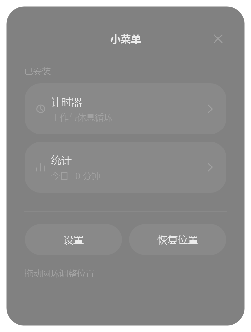
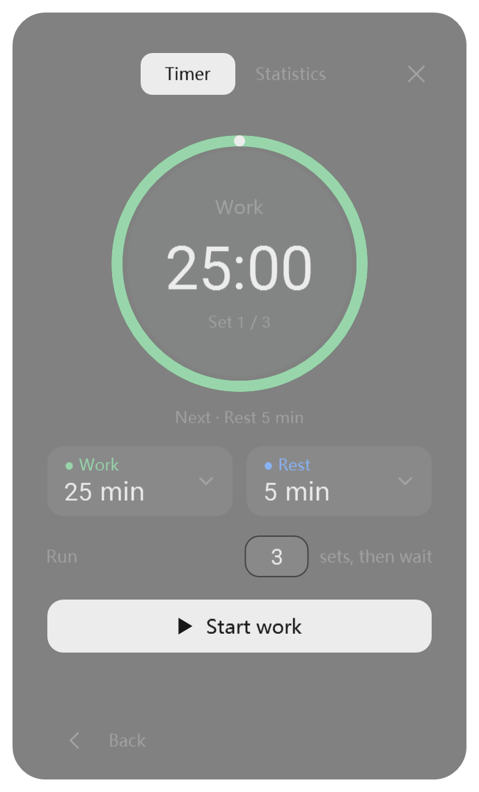
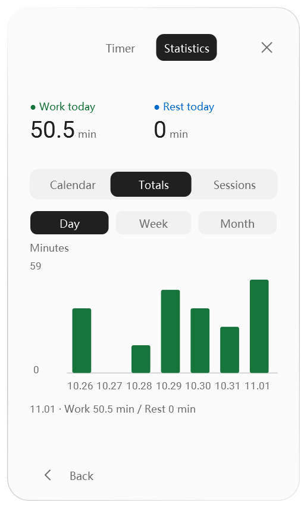

# Codex Mini Menu

A lightweight floating utility menu for Codex, featuring work/rest timers and activity statistics, with more tools to come.

**Windows 10 / 11 · .NET Framework 4.8 · English / 简体中文**

[简体中文](README.zh-CN.md) · [Download](https://github.com/originnal090/codex-mini-menu/archive/refs/heads/main.zip) · [Report an issue](https://github.com/originnal090/codex-mini-menu/issues)

## See it in motion


The slider follows your pointer with subtle damping. Text changes color exactly where the thumb passes, including during the settling animation. Buttons compress on press and gently rebound on release.

*Captured from the application's native WPF controls in a dedicated demonstration surface. The GIF loops; animation smoothness depends on your viewer.*

## A small menu, ready for more tools

The floating launcher follows the active Codex window. Open the menu, choose a tool, and return using the back button. You can drag the launcher to a comfortable position, and the timer keeps running when the panel is closed.

<table>
<tr><th>Mini menu</th><th>Work / rest timer</th><th>Activity statistics</th></tr>
<tr>
<td></td>
<td></td>
<td></td>
</tr>
</table>

*Screenshots show both supported languages and themes. Statistics use demonstration data.*

## Features

- **Work / rest cycles.** Configure each phase from 1 second to 24 hours. One group contains work followed by rest; run 1–99 groups, then wait for your next start. The default is one group.
- **Circular progress.** See the current phase, remaining time and group count. Pause, resume or reset from the timer panel.
- **Separate statistics.** Work and rest have distinct totals and colors. Explore a 13-week calendar, daily / weekly / monthly totals, and a timeline of individual active spans.
- **Actual active time.** Pauses are excluded. Resetting a running cycle retains time already spent. Current elapsed time is included in the statistics display.
- **Responsive interactions.** Drag the statistics selector with a mouse or touch, or use the arrow keys. Buttons provide elastic feedback, and surfaces respond to pointer movement.
- **Personal settings.** English and Simplified Chinese, appearance controls, and optional reminder sounds with custom audio and preview.
- **Local storage.** Timer state, preferences and history are stored in `%USERPROFILE%\.codex\timer-data`.

More utility modules are planned. The current release includes the timer and statistics modules.

## Install

1. Use **Code → Download ZIP**, or the [download link](https://github.com/originnal090/codex-mini-menu/archive/refs/heads/main.zip).
2. Extract the entire archive.
3. Run **`install.cmd`** from the extracted folder.
4. Open **Codex Mini Menu** from the desktop shortcut. The tray menu also provides open, position reset and exit actions.

The installer registers the local Codex plugin and creates shortcuts. Upgrading preserves your timer state and preferences. Windows includes the required .NET Framework on supported installations; the application does not require a Node.js or Python runtime.

Run **`uninstall.cmd`** to uninstall. For portable inspection before installation, the compiled application is in `plugin/bin/`.

## How a cycle works

```text
Work → Rest → next group … → final rest ends → wait
```

Configure durations and group count before starting. Sound controls are under **Settings → Sound**. Returning to the menu or closing the panel keeps the timer active.

The countdown follows an absolute deadline. After sleep or an application restart, it catches up to the appropriate phase or completion. Notifications cannot play while the application is closed or Windows is asleep.

## Build and test

Use Windows PowerShell with .NET Framework 4.8 installed:

```powershell
powershell -ExecutionPolicy Bypass -File source/scripts/build.ps1
powershell -ExecutionPolicy Bypass -File source/scripts/test-cycle.ps1
powershell -ExecutionPolicy Bypass -File source/scripts/test-stats.ps1
powershell -ExecutionPolicy Bypass -File source/scripts/test-work-rest.ps1
powershell -ExecutionPolicy Bypass -File source/scripts/package.ps1
```

`build.ps1` runs the core timer checks and builds the executable. `package.ps1` creates a complete distributable ZIP under `dist/`. Additional scripts cover menu navigation, settings, statistics views, host selection and real Windows window-follow behavior. UI tests require an interactive Windows desktop.

```text
plugin/          Local plugin, modules, assets and compiled application
source/src/      C# / WPF implementation
source/tests/    Regression tests and native demo capture
source/scripts/  Build, verification and packaging scripts
docs/images/     Screenshots and animation
```

## Contributing

Bug reports and suggestions are welcome through [Issues](https://github.com/originnal090/codex-mini-menu/issues). For code changes, fork the repository and open a pull request describing the behavior and relevant validation. Pull requests are reviewed by the maintainer before acceptance.

## Credits and licensing

The interface uses Microsoft YaHei and the bundled Roboto font. Roboto's license is included in [LICENSE-Roboto.txt](plugin/assets/fonts/LICENSE-Roboto.txt). A license for the project source has not yet been selected.

This is an independent community project for use with Codex.
