# Codex 小菜单

**2.14.0：圆角与倾斜优化。** 右侧控件与卡片圆角同心，文字绘制保持稳定，圆环跟随整张卡片倾斜。通过反光分层与内容缓存改善动画流畅度。[实测与代价](docs/card-refinement-2.14.0.md)

**2.13.0：银色玻璃闪卡。** 按住右键移动鼠标，整张菜单卡片随之倾斜，银白高光随角度流动；松开后柔和回正，计时保持实时更新。[升级说明](docs/silver-card-2.13.0.md)

<p align="center">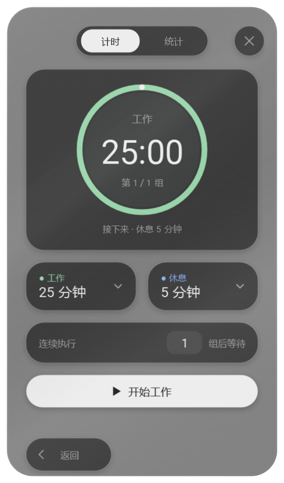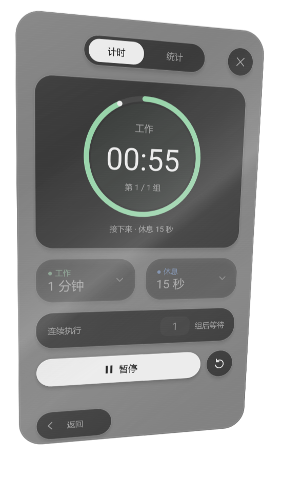</p>

**2.12.0：悬浮岛界面。** 完整玻璃卡片内的导航、计时、统计、上下文与设置采用统一的圆润功能岛，支持小屏幕内容滚动。[改版说明](docs/menu-islands-2.12.0.md)

<p align="center">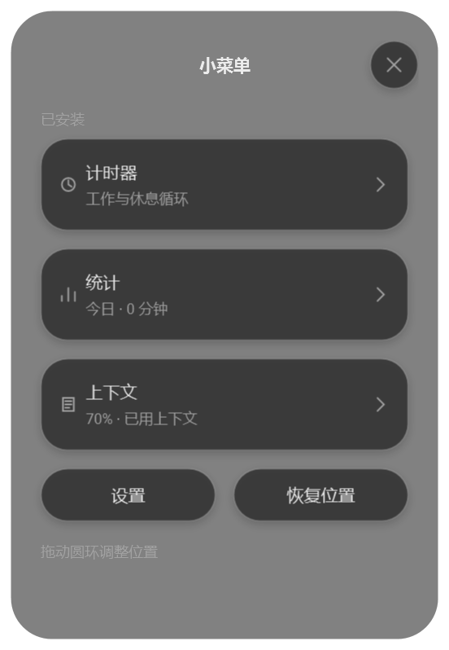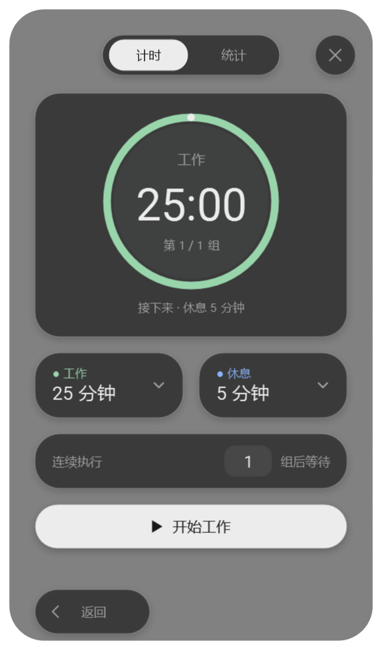</p>

2.11.0 新增「上下文」模块：圆环中心显示当前聊天的已用百分比，80% 变橙，90% 变红并提醒一次；切换聊天后自动更新。[功能与兼容性说明](CONTEXT.md)。

**跟随 Codex 的 Windows 悬浮工具菜单。** 从圆环扩散展开，跟随主题切换配色，以银色反光、可调透明度和磨砂玻璃质感融入桌面。内置工作／休息计时与打卡式活动热力图，更多实用工具持续扩展中。

**Windows 10 / 11 · .NET Framework 4.8 · 简体中文 / English**

[English](README.md) · **简体中文** · [下载安装](https://github.com/originnal090/codex-mini-menu/archive/refs/heads/main.zip) · [反馈与建议](https://github.com/originnal090/codex-mini-menu/issues)

## 从圆环展开的小菜单

点击悬浮圆环，菜单从圆环所在位置扩散展开，收起时回到原处。悬浮入口跟随当前 Codex 窗口，也可以自由拖动；进入计时或统计后，左下角可返回菜单。

<p align="center">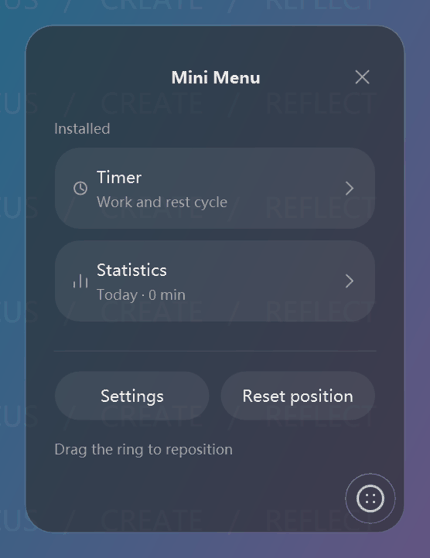</p>

## 跟随 Codex 主题与配色

读取 Codex 的外观配置，自动跟随明暗主题及配色变化。背景、文字、控件和强调色一起调整；切换外观时继续保留当前计时状态。

<table>
<tr><th>深色主题</th><th>浅色主题</th></tr>
<tr><td>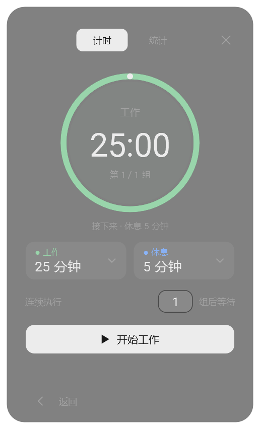</td><td>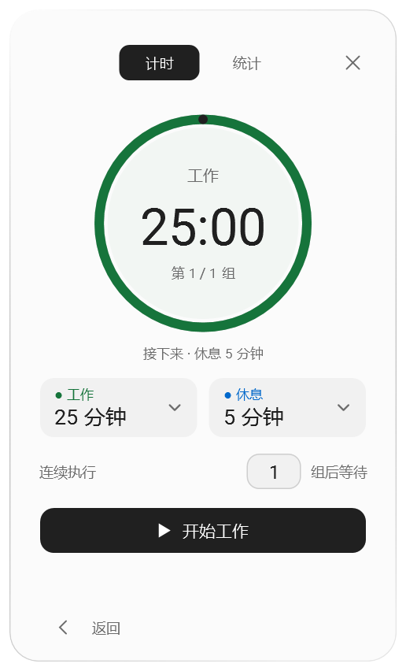</td></tr>
</table>

## 银色闪卡与细腻的操作反馈

按住右键移动鼠标时，整张银色玻璃卡片随角度产生流动反光；松开后自动回正。统计滑轨带轻微阻尼，滑块覆盖到的文字即时换色；按钮按下时弹性压缩并出现内阴影，释放后轻微回弹。

<p align="center">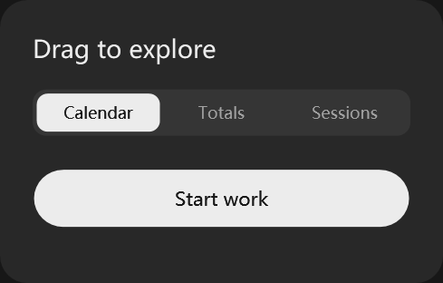</p>

*系统关闭动画时，松开右键会立即回正。*

## 打卡式热力图：看见专注的积累

热力图根据实际计时记录自动生成。每屏展示 13 周，可切换工作／休息、翻阅历史，并点击日期查看当天分段。总量视图按日、周、月汇总，两类时间使用不同颜色。

<table>
<tr><th>每日活动热力图</th><th>工作／休息分类统计</th></tr>
<tr><td>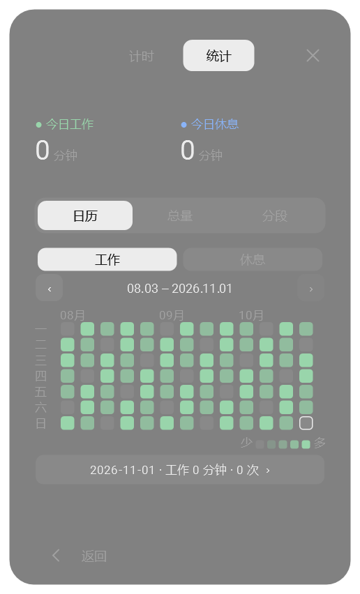</td><td>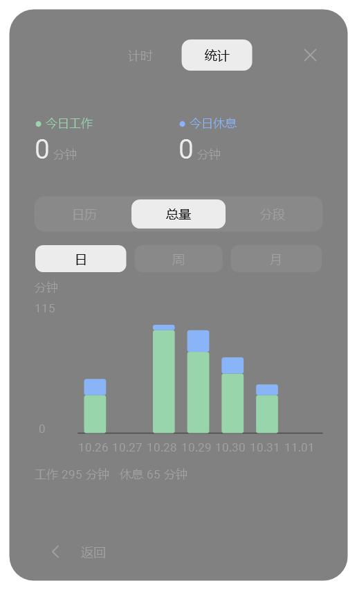</td></tr>
</table>

*统计图片使用演示数据。暂停时间不计入；当前正在进行的时间也会显示，重置会保留已经执行的有效时长。*

## 可调透明度与磨砂玻璃质感

在 **设置 → 外观** 中将透明度调到 0–90%，菜单、计时器和悬浮圆环同步生效。半透明填充、渐变边缘与背景模糊形成玻璃层次，让菜单与桌面背景自然融合。

<table>
<tr><th>较低透明度 · 15%</th><th>较高透明度 · 75%</th></tr>
<tr><td>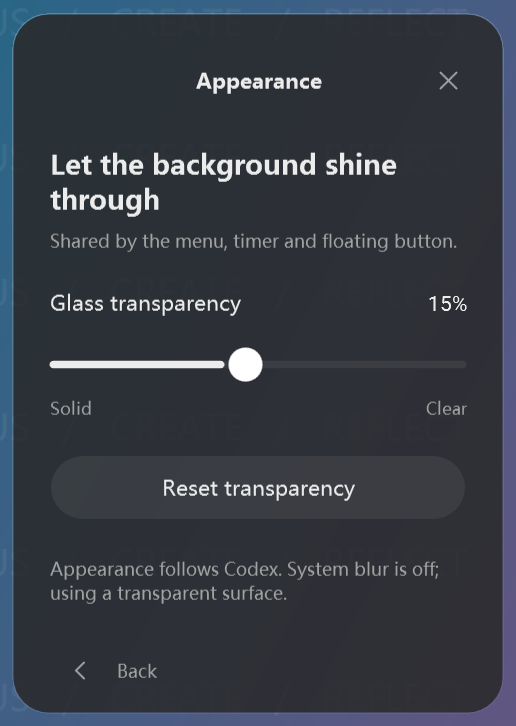</td><td>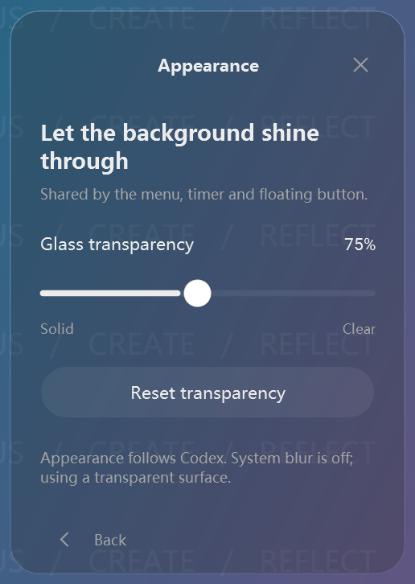</td></tr>
</table>

*上图在统一的演示背景上实拍；录制环境关闭了系统模糊，显示为半透明表面。背景模糊取决于 Windows 合成能力和系统透明效果设置，具体观感会随桌面背景变化。*

## 提示音由你选择

在 **设置 → 提示音** 中随时开关提醒、选择自己的 WAV / MP3 文件、试听或恢复系统默认音效。

<p align="center">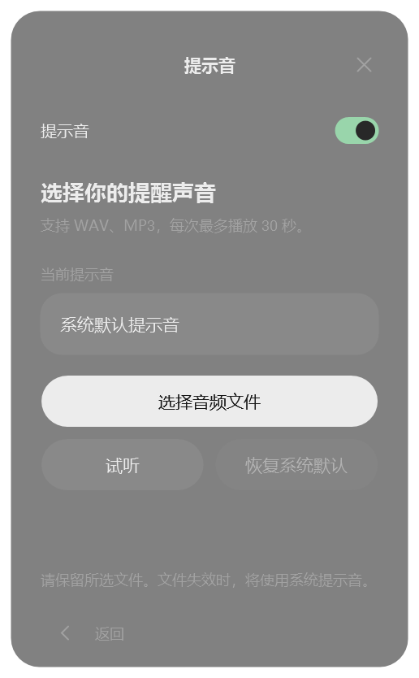</p>

## 工作与休息，按组执行

- 工作与休息时长分别设置，每段支持 **1 秒至 24 小时**，通过时／分／秒滚轮调整。
- 一组包含 **工作 → 休息**。默认执行一组，也可指定 **1–99 组**，最后一组结束后等待再次开始。
- 环形进度显示阶段、剩余时间和组数，支持暂停、继续与重置。
- 收起菜单后继续计时。休眠或退出期间不能即时提醒；恢复后按绝对截止时间推进到相应阶段或结束。

## 安装与开始使用

1. 点击 [下载 ZIP](https://github.com/originnal090/codex-mini-menu/archive/refs/heads/main.zip)，或使用仓库的 **Code → Download ZIP**。
2. 完整解压，运行 **`install.cmd`**。
3. 从桌面快捷方式 **Codex Mini Menu** 打开；也可以通过系统托盘打开菜单、恢复位置或退出。

安装器会注册本地 Codex 插件并创建快捷方式。升级保留计时状态和偏好。运行依赖 .NET Framework 4.8；无需 Node.js 或 Python。卸载请运行 `uninstall.cmd`。

计时状态、外观、声音偏好与历史保存在 `%USERPROFILE%\.codex\timer-data`。

## 构建与验证

```powershell
powershell -ExecutionPolicy Bypass -File source/scripts/build.ps1
powershell -ExecutionPolicy Bypass -File source/scripts/test-cycle.ps1
powershell -ExecutionPolicy Bypass -File source/scripts/test-stats.ps1
powershell -ExecutionPolicy Bypass -File source/scripts/test-work-rest.ps1
powershell -ExecutionPolicy Bypass -File source/scripts/package.ps1
```

在 Windows PowerShell 中运行。安装包生成在 `dist/`；UI 验证需要交互式 Windows 桌面。源码位于 `source/src/`，测试位于 `source/tests/`，构建与验证脚本位于 `source/scripts/`。

## 参与项目

欢迎通过 [Issues](https://github.com/originnal090/codex-mini-menu/issues) 提交建议和问题，或 Fork 后提交 Pull Request，说明改动和验证结果，由维护者审核。

## 字体与许可

界面使用微软雅黑与 Roboto。Roboto 的许可证见 [LICENSE-Roboto.txt](plugin/assets/fonts/LICENSE-Roboto.txt)；项目源码许可证尚未指定。本项目是面向 Codex 的独立社区工具。
