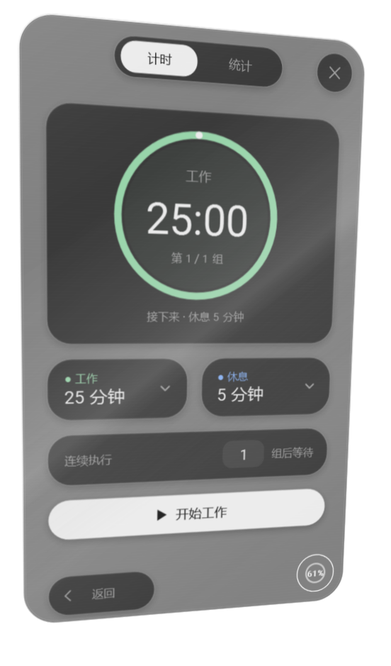

# 2.14.0：同心圆角、稳定字形与流畅倾斜

右侧圆形控件和外卡片采用同一圆角圆心计算。菜单上下展开时，关闭按钮位于与圆环相对的一端，页面主体和返回按钮保持原有位置。

卡片倾斜时，圆环的实时画面与卡片共用同一透视变换；独立圆环窗口暂时隐藏画面，回正后恢复。屏幕边缘的原生轮廓包含圆环，窗口跟随导致相对位置变化时同步更新。

文字显式保留正常界面的 Display / Grayscale 绘制设置。静态材质、文字与阴影使用缓存，动态反光单独更新；正常显示和倾斜切换的数字源字形逐像素比较一致，避免切换绘制设置引起的字形和粗细突变。倾斜本身仍有正常的透视缩放。

## 本机对照

相同可见计时卡片（计时未启动）和圆环，WPF 渲染层级 2、150% 显示缩放；每次运行 6 秒，帧间隔跳过首秒预热。源码基线为 f247bc4（2.13.0），同一基准程序分别编译两版源码。

| 指标 | 2.13.0 | 2.14.0 |
| --- | ---: | ---: |
| 渲染回调次数 / 秒 | 40.3 | 102.2 |
| 帧间隔中位数 | 24.74 ms | 10.02 ms |
| 帧间隔第 95 百分位 | 27.39 ms | 11.89 ms |
| CPU，单个逻辑核心等效占用 | 88.6% | 78.3% |
| 测试结束时进程私有内存 | 475.1 MiB | 317.6 MiB |

这是 WPF 渲染回调节奏，不是硬件呈现追踪，也不保证所有设备达到固定帧率。CPU 指标以单个逻辑核心为基准。纹理缓存会占用图形内存，显存未单独计量；本次进程内存整体下降。继续使用现有 WPF 运行环境，安装包无需增加新的运行时依赖。

基准命令：`source/scripts/measure-card.ps1`，程序：`source/tests/CardPerformance.cs`。比较记录保存在 `source/artifacts/card-performance/`。

## 验证

回归覆盖真实圆心坐标、字形像素一致性、圆环恢复、快速打开/隐藏、四个屏幕边缘、相对位置移动，并保留原有实时计时、主题、设置、统计、上下文和窗口跟随检查。审查发现的边缘裁切与位置滞后均增加了先失败、修复后通过的测试。
