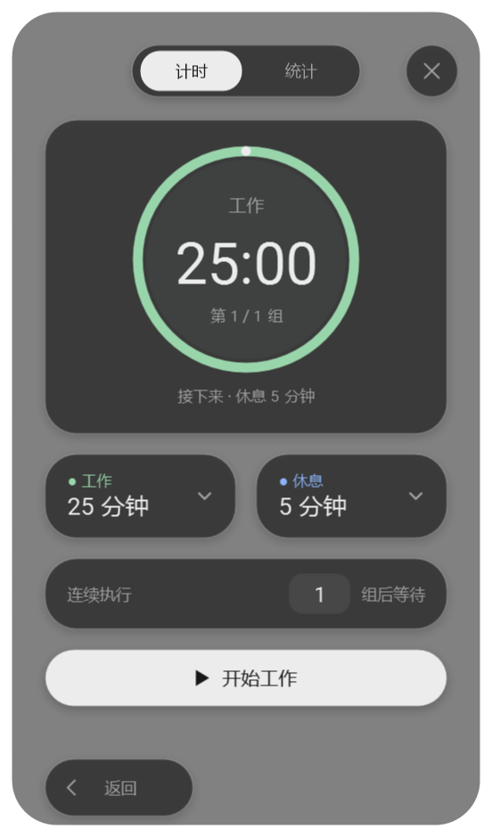
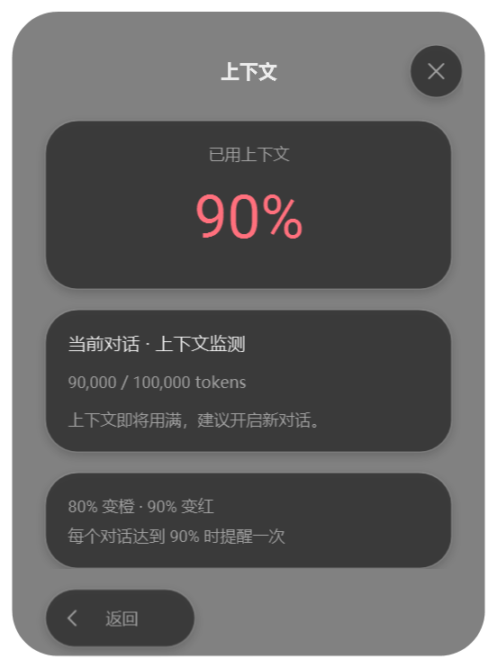

# 小菜单 2.12.0

完整的玻璃卡片内，导航、计时、时长、循环、统计和设置分区采用统一悬浮岛外观。圆角、柔和阴影、细描边与 14 DIP 留白形成清晰层次，材料随 Codex 外观和透明度设置实时更新。

- 首页功能入口、设置入口、返回与关闭按钮使用统一表面。
- 上下文占比模块、圆环中心读数和一次性提醒完整保留；详情页和提醒卡片采用同一套悬浮岛样式。
- 计时主岛与工作/休息、循环及操作区分层；时长编辑器沿用原有滚轮、预设和键盘操作。
- 统计汇总、切换滑轨、日历、总量和分段图置于独立功能岛。
- 语言、透明度、提示音设置的说明、输入和选择区按功能组合。
- 卡片宽 368 DIP，计时和统计保持等高；切页时内容高度与窗口同步。
- 屏幕可用高度不足时，内容区滚动，导航和返回始终可见；自定义配色的岛屿表面按实际颜色保持文字对比度。

本地验证命令：`source/scripts/build.ps1`、`test-islands.ps1`、`test-structure.ps1`、`test-settings.ps1`、`test-stats-view.ps1`、`test-work-rest.ps1`、`test-back.ps1`、`test-cycle.ps1`、`test-stats.ps1`、`test-window.ps1`。

上下文模块另由 `test-context.ps1`、`test-context-view.ps1` 验证解析、阈值、提醒去重及界面集成。

