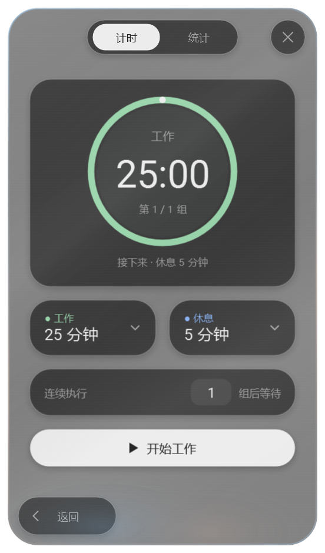
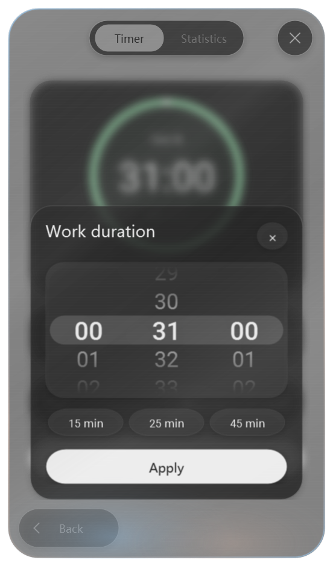

# 2.15.0：浮岛动效与主题光效

从包含浮岛编辑器的 9f1dba2 继续开发。

- 上浮时间由 380 ms 减为 190 ms。缓存展开中的整个编辑器，背景模糊使用低分辨率缓存并淡入，变换与透明度直接动画。
- 删除时／分／秒标签行，标题与滚轮保持 12 DIP 间距；键盘与无障碍单位名称保留。
- 圆环窗口保持原有透明度与合成表面，倾斜时通过空窗口区域隐藏；回正至原位并完成画面呈现后，在同一交接中恢复原生圆环和卡片轮廓。
- 反光在 180 ms 内柔和增强，松手时从当前亮度渐退；快速点击不会跳到最大亮度。
- 主题关联的冷暖渐变描边缓慢旋转，底部柔和径向渐变通过大小、位移和透明度形成呼吸弥散光。隐藏时停止动画，遵循应用与 Windows 动画设置。

## 本机性能对照

相同可见窗口、150% 显示缩放、WPF 渲染层级 2，交替打开工作／休息编辑器 12 次，前两次预热。比较打开后前 190 ms 的渲染回调间隔。

| 指标 | 9f1dba2 | 2.15.0 |
| --- | ---: | ---: |
| 上浮动画时长 | 380 ms | 190 ms |
| 回调间隔中位数 | 20.50 ms | 18.42 ms |
| 回调间隔 P95 | 27.00 ms | 26.48 ms |
| 打开准备时间中位数 | 6.94 ms | 9.22 ms |
| 测试结束进程私有内存 | 386.5 MiB | 352.5 MiB |

上浮时长减少 50%，本次采样的帧间隔中位数减少约 10%。低分辨率背景缓存带来约 2 ms 的额外准备时间。持续主题动画会增加展开状态的绘制工作；测试期间单核等效 CPU 从 89.8% 到 95.1%。这些是 WPF 回调与进程指标，不代表硬件呈现帧率，也不保证每台设备得到相同结果。

`source/scripts/measure-duration.ps1` 可重现浮岛基准；`-SourceDirectory` 可指定基线源码。`test-motion-polish.ps1` 覆盖反光连续性与圆环生命周期；完整验证使用 `dev.ps1 -Action TestUI`。

本次完整数据与桌面回归通过 4609 项检查，包含 27 项真实桌面窗口跟随检查。独立审查发现的原生窗口区域重入、Windows 动画设置变更响应已修正。`dev.ps1 -Action Package` 生成 2.15.0 ZIP；本机安装与插件缓存的可执行文件按 SHA-256 核对。

