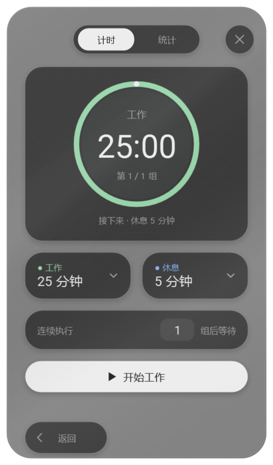
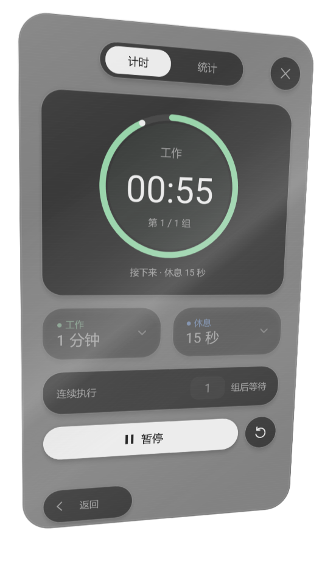

# 2.13.0 银色玻璃闪卡

整个展开的小菜单是一张银色玻璃卡片，内部悬浮岛随卡片一起转动。卡面叠加细腻拉丝、银白反光带和抛光边缘，并继续使用现有玻璃透明度设置。

在卡片内按住鼠标右键，移动鼠标即可摆动。高光随倾斜角度扫过卡面；松开右键后约 280 毫秒柔和回正。按 Esc、失去鼠标捕获、切换窗口或关闭菜单，也会恢复正常状态。系统关闭动画时，松开后立即回正。

倾斜期间计时数字保持实时更新。回正后继续操作原来的计时、统计、上下文与设置控件。拖动圆环仍然用于调整插件位置。

## 实现与验证

采用 WPF 原生实时三维界面承载，保留现有控件实例与状态。卡片的三维投影和原生窗口轮廓共用同一组计算；圆环挖空始终对齐独立的位置锚点。卡片静止时停止姿态动画回调。

测试覆盖透视与轮廓的一致性、实时倒计时、捕获丢失、右键释放、Esc、页面切换、编辑器、关闭、切换窗口后的焦点保留、明暗主题及 0/42/90% 透明度，并回归原有布局、计时交互、统计、设置、返回定位、窗口跟随和上下文功能。

设计参考：[RuiC-card-skill](https://github.com/HRuiCcc/RuiC-card-skill) 的视角相关反光思路。此版本使用适配本插件的 WPF 实现。
